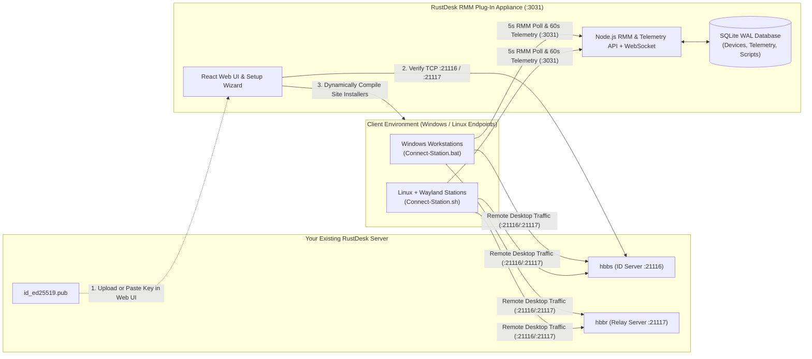

<div align="center">

# ⚡ RustDesk RMM & Telemetry Plug-In Appliance

**Turn any self-hosted RustDesk Server (`hbbs` / `hbbr`) into a complete RMM, Live Telemetry, Software Inventory & Zero-Touch Unattended Endpoint Management Platform.**

[](https://github.com/ll4gp/rustdesk-rmm-appliance/releases)
[](https://github.com/ll4gp/rustdesk-rmm-appliance)
[](https://github.com/ll4gp/rustdesk-rmm-appliance)
[-f59e0b?style=for-the-badge)](./docs/Station-Onboarding-Windows-Linux.md)
[](./LICENSE)

[**Quick Start**](#-60-second-quick-start) •
[**How It Works**](#-architecture--how-it-works) •
[**Feature Matrix**](#-why-use-this-appliance) •
[**Documentation / Wiki**](#-documentation--wiki) •
[**Updating**](#-1-click-zero-downtime-updates)

</div>

---

## 🎯 Overview

Open-source **RustDesk Server (`hbbs` / `hbbr`)** is fast and lightweight, but the free self-hosted edition does not include a web dashboard, live online/offline fleet status, hardware telemetry, software inventory, or remote script execution (RMM).

**RustDesk RMM & Telemetry Plug-In Appliance** solves this without forcing you to replace or migrate your existing RustDesk server:
1. **Drop it into any environment** in a single Docker container (`port 3031`).
2. **Load your existing `id_ed25519.pub` key** and server IP/domain in the Web UI (with a built-in live TCP reachability tester for ports `21115–21117`).
3. **Deploy dynamically generated 1-Click Installers** (`Connect-Station.bat` for Windows, `Connect-Station.sh` for Linux) that configure your RustDesk server, enable **unattended password access** (including **Linux Wayland/Xorg screen-share prompt bypass**), and start a lightweight **5-second fast-polling RMM & Telemetry agent**.

---

## 📊 Why Use This Appliance?

| Capability | Standard Open-Source RustDesk (`hbbs`/`hbbr`) | With **RustDesk RMM Plug-In Appliance** |
| :--- | :---: | :---: |
| **Self-Hosted Remote Desktop Relay** | ✅ | ✅ *(Uses your existing server or bundled stack)* |
| **Real-Time Web Dashboard (Online / Offline Status)** | ❌ | ✅ *(Live WebSocket status + `:21116` bridge)* |
| **Bring Your Own `id_ed25519.pub` Key via Web UI** | ❌ | ✅ *(Upload `.pub` file or paste key in browser)* |
| **1-Click Windows Station Setup (`.bat` + PS1 1-Liner)** | ❌ | ✅ *(Auto-elevates, configures TOML + SYSTEM service)* |
| **1-Click Linux + Unattended Wayland Setup (`.sh`)** | ❌ | ✅ *(Configures GDM `WaylandEnable=false` + Polkit rules)* |
| **Remote Script Deployment (RMM) with Live Output** | ❌ | ✅ *(5-second execution + Cross-OS PS1-to-Bash translation)* |
| **Live CPU, RAM & Disk Telemetry Sparklines** | ❌ | ✅ *(60-second hardware metrics & historical charts)* |
| **Hardware Specs, BIOS Serial & Installed App Inventory** | ❌ | ✅ *(Automatic WMI / DMI + Registry / `dpkg` / `rpm` sync)* |
| **1-Click Launch (`rustdesk://<id>`) from Browser** | ❌ | ✅ *(Launch remote desktop directly from device cards)* |

---

## 🏗 Architecture & How It Works



---

## 🚀 60-Second Quick Start

You can deploy the appliance in **two modes**:
- **Mode 1 — Plug-In Mode (Default)**: Runs **only** the RMM Appliance on port `3031` (`docker-compose.yml`). Zero conflict with ports `21115–21119` on an existing RustDesk server.
- **Mode 2 — All-in-One Full Stack**: Spins up `hbbs` + `hbbr` + the RMM Appliance together (`docker-compose.fullstack.yml`) for brand-new sites.

### Option A: Linux Host (Ubuntu, Debian, RHEL, Rocky, Proxmox, Mini-PC)
```bash
git clone https://github.com/ll4gp/rustdesk-rmm-appliance.git
cd rustdesk-rmm-appliance
chmod +x deploy-appliance.sh
sudo ./deploy-appliance.sh "Your Organization Name"
```
> *If Docker is not installed yet, `deploy-appliance.sh` installs Docker Engine automatically and opens port `3031/tcp` in `ufw` / `firewalld`.*

### Option B: Windows Host (Windows Server / Windows 10/11 Pro with Docker Desktop)
```powershell
git clone https://github.com/ll4gp/rustdesk-rmm-appliance.git
cd rustdesk-rmm-appliance
.\Deploy-Appliance.bat
```
> *Auto-detects your LAN & Tailscale IPs, detects any local `id_ed25519.pub` key, opens TCP port `3031` in Windows Firewall, and builds the container.*

---

## 🔑 First-Time Web UI Setup (1 Minute)

1. Open **`http://<APPLIANCE_IP>:3031`** in your browser.
   - **Default Login**: `admin` / `admin123`
2. Click **"Load Server Key & Configure"** on the welcome banner (or go to **Appliance Setup** in the left sidebar).
3. Enter your **RustDesk ID Server (`hbbs`) IP or Domain** (and optional Relay server) and click **"Test Connection to RustDesk Server"** to verify live TCP latency.
4. Click **"Upload `id_ed25519.pub` File"** (or paste your 44-character public key) and click **"Save & Activate Appliance"**.
5. Roll out the pre-configured agents to your endpoints:

### Enroll Windows Endpoints
- **Download 1-Click Installer**: `http://<APPLIANCE_IP>:3031/api/agent/installer.bat` (`Connect-Station.bat`)
- **Or Run 1-Line PowerShell (as Admin)**:
  ```powershell
  irm http://<APPLIANCE_IP>:3031/api/agent/onboard.ps1 | iex
  ```

### Enroll Linux Endpoints (with Unattended Wayland/Xorg Setup)
- **Download 1-Click Installer**: `http://<APPLIANCE_IP>:3031/api/agent/installer.sh` (`Connect-Station.sh`)
- **Or Run 1-Line Terminal Command**:
  ```bash
  curl -fsSL http://<APPLIANCE_IP>:3031/api/agent/installer.sh | sudo bash
  ```

---

## 📚 Documentation & Wiki

Full guides for administrators, MSPs, and self-hosters are located in the [`/docs`](./docs/Home.md) directory:

- 📖 **[Wiki Home & Architecture Overview](./docs/Home.md)**
- 🛠 **[Installation & Deployment Guide (Plug-In vs. Full-Stack & HTTPS)](./docs/Installation-Guide.md)**
- 🔌 **[Connecting an Existing RustDesk Server & Loading `id_ed25519.pub`](./docs/Connecting-Existing-RustDesk.md)**
- 💻 **[Station Onboarding: Windows & Linux (Unattended Wayland Setup)](./docs/Station-Onboarding-Windows-Linux.md)**
- ⚡ **[RMM Script Execution, Cross-OS Translation & Live Telemetry](./docs/RMM-Scripts-and-Telemetry.md)**
- 🔄 **[1-Click Updating, Backup & Multi-Site MSP Management](./docs/Updating-and-Backup.md)**

---

## 🔄 1-Click Zero-Downtime Updates

All persistent site data (`database.sqlite`, `.env`, and `id_ed25519*` keys) is stored outside the container image and ignored by Git. To pull the latest release and rebuild in place without losing any devices or settings:

- **Linux**:
  ```bash
  sudo ./update-appliance.sh
  ```
- **Windows**:
  Double-click **`Update-Appliance.bat`**

---

## 📄 License

Released under the [MIT License](./LICENSE).
